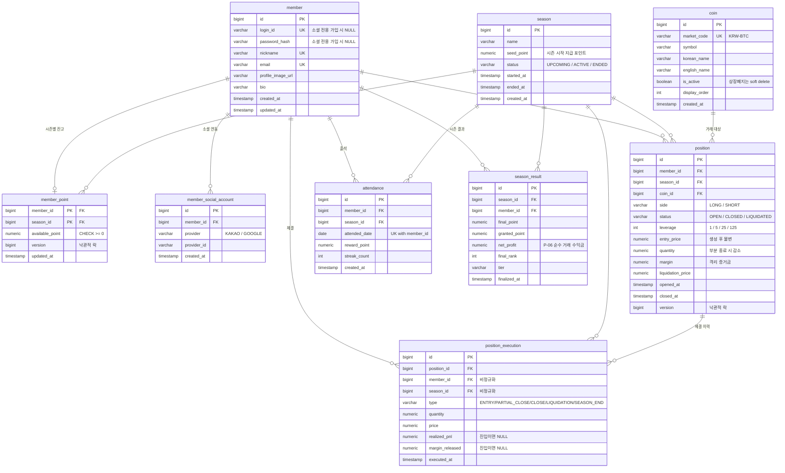

# BiToday ERD (초안 v1)

> 요구사항분석서 **v6** 기준
> 결정 근거는 **[설계 트레이드오프 & 알려진 한계]** 문서를 참고.

테이블 **9개**. 이 중 경합이 발생하는 건 `member_point`와 `position` **둘뿐**이며, 나머지는 append-only이거나 거의 불변이다.

---

## 전체 관계도



---

## 타입 규격

실측 근거: 업비트 KRW 마켓 289개 기준 **가격 최대 정수 9자리**(BTC 109,749,000), **최대 소수 6자리**(BTT 0.000449).

| 용도 | 타입 | 정수/소수 | 비고 |
| --- | --- | --- | --- |
| 가격 | `NUMERIC(20, 8)` | 12 / 8 | `entry_price`, `price`, `liquidation_price` |
| **수량** | `NUMERIC(30, 8)` | 22 / 8 | ⚠️ 저가 코인 × 125배에서 폭증 (아래 참고) |
| 포인트 | `NUMERIC(24, 8)` | 16 / 8 | 잔고·증거금·실현손익·보상 |

> **수량이 함정이다.** 최저가 코인(BTT 0.000449원)에 시드 100만으로 125배 진입하면 수량이 **2,783억 개(정수 12자리)** 가 된다. `NUMERIC(20,8)`은 정수부가 12자리라 조금만 불려도 오버플로. 그래서 수량만 `(30,8)`.

---

## 저장 여부 판단 원칙

아래 표는 이 ERD 전반에서 반복 적용된 기준이다. "무엇을 컬럼으로 둘 것인가"를 매번 감으로 정하지 않기 위한 규칙이다.

| 값의 성격 | 판단 | 이 ERD의 사례 |
| --- | --- | --- |
| 파생 가능 + **계산 규칙이 고정** | **저장하지 않는다** | `initial_quantity`, 증거금 합계, 미실현 손익, 시즌 최고 티어(peak) |
| 파생 가능 + **규칙이 정책이라 바뀔 수 있음** | **스냅샷으로 저장한다** | `season_result.tier`·`final_rank`, `attendance.reward_point` |
| **불변** + 주 조회 조건 | **비정규화하여 저장한다** | `position_execution.member_id`·`season_id` |
| 파생 불가 + 재계산이 비대칭적으로 비쌈 | 저장한다 | `attendance.streak_count` |

두 번째 행이 핵심이다. 티어 임계값이나 출석 보상액은 **정책**이므로 나중에 바뀔 수 있다. 매번 계산하는 구조라면 기준이 바뀌는 순간 **과거 시즌의 티어와 순위가 소급해서 변해버린다.** 확정된 사실은 확정된 채로 남아야 한다.

같은 이유로, `season_id`처럼 **나중에 추가하면 PK 변경과 전체 백필이 필요한 것은 미리 넣고**(비대칭적으로 비쌈), 티어 로직처럼 **나중에 붙여도 비용이 같은 것은 미룬다.**

---

## 테이블별 메모

### member / member_social_account

- `login_id`·`password_hash`를 **NULL 허용** — 소셜 전용 가입 대비. PostgreSQL은 UNIQUE 컬럼에 NULL을 여러 개 허용한다.
- `nickname` UNIQUE — 리더보드 식별용.
- `UNIQUE(provider, provider_id)` — **같은 소셜 계정으로 복수 가입 차단**(리더보드 어뷰징 방지).
- 소셜 **액세스 토큰은 저장하지 않는다.** 로그인 확인 용도뿐이라 유출 위험만 늘어난다.

### member_point 🔴 경합

- PK가 `(member_id, season_id)` 복합키 — 시즌 리셋이 "덮어쓰기"가 아니라 **새 행 생성**이 되어 과거 잔고가 보존된다.
- **`member`에서 분리한 이유**: 프로필 조회가 막혀서가 아니라(PostgreSQL MVCC라 일반 SELECT는 안 막힘), ① UPDATE마다 넓은 `member` 행 전체가 새 튜플로 복사되는 비용 ② `@Version`을 `member`에 붙이면 프로필 수정까지 낙관적 락에 걸려 실험 변수가 섞이기 때문.
- **`CHECK (available_point >= 0)`** — 동시성 버그의 전형적 증상을 DB가 최후 방어. NFR-01 실험에서 "락 없이 N건 위반 → 비관적 락 0건" 형태의 정량 증거로 쓴다.
- **증거금 합계를 저장하지 않는다.** `SUM(margin) WHERE status='OPEN'`으로 계산. 저장하면 포지션 개폐마다 잔고 행을 또 건드려 경합이 늘어난다.

### coin

- **가격 컬럼이 하나도 없다.** 현재가·캔들·거래량은 전부 업비트에서 온다. 마크 가격은 DB가 아니라 메모리/Redis에 `{price, receivedAt}` 형태로 보관(C-07 신선도 판정에 수신 시각이 필요).
- **삭제 금지, `is_active`로 soft delete.** 과거 포지션·체결 이력이 FK로 참조하므로 행을 지우면 거래 내역이 깨진다.
- PK를 `market_code`가 아닌 대리키로 둔 이유: 청산 엔진이 `coin_id`로 대량 스캔하는데 **BIGINT가 VARCHAR보다 인덱스가 작고 비교가 빠르다.**

### position 🔴 경합

- **헤지 모드라 `(member_id, coin_id)`에 UNIQUE를 걸면 안 된다.** 같은 코인에 롱·숏을, 심지어 롱만 여러 개도 보유 가능해야 한다.
- **미실현 손익 컬럼이 없다.** 마크 가격마다 변하므로 조회 시 계산(O-06).
- **`initial_quantity`를 두지 않는다.** 진입 체결 레코드가 곧 초기 수량이며, 진입·체결이력 INSERT가 같은 트랜잭션(NFR-02)이라 손실 위험이 없다.
- **부분 종료 시 청산가 재계산 불필요.** 청산가 공식에 수량이 들어가지 않고 증거금을 비례 반환하므로 실효 레버리지가 유지된다. (검증: 진입가 20,000·10배·MMR 0.5% → 부분 종료 전후 모두 18,100)
- `status` 3종이면 충분하다. **부분 종료는 상태가 아니라 수량 감소**이고, 중간 상태(`CLOSING`)는 락 획득 후 status 재확인으로 대체된다(NFR-03).
- `liquidation_price`를 저장하는 이유는 청산 엔진이 인덱스로 대상을 걸러내기 위함 → NFR-07 처리량에 직결.

### position_execution

- **절대 UPDATE하지 않는 append-only 테이블.** 락 경합이 없다.
- `member_id`·`season_id` **비정규화** — 불변값이라 정합성 위험이 없고 O-09의 주 조회 조건이라 JOIN 없이 조회된다. 판단 기준은 "비정규화 금지"가 아니라 **값이 변하느냐**.
- `margin_released`는 표시용이 아니라 **검증용**.
- **반올림 규칙**: 부분 종료는 `margin × (종료수량/현재수량)`을 반올림해 반환하되, **전량 종료·청산·시즌정산에서는 남은 margin 전액**을 반환한다. 그래야 누적 오차가 마지막에 흡수되어 검증식이 오탐을 내지 않는다.

### attendance

- **출석은 자동 처리한다. 유저가 버튼을 누르지 않는다.** (2026-10-20 변경 — 버튼 방식에서 전환)
- **트리거는 세 지점이다.** `AttendanceService.checkInIfAbsent(memberId)` 하나를 세 곳에서 호출한다.

| 트리거 | 커버하는 경우 |
| --- | --- |
| ① 로그인 | 로그인 유지를 쓰지 않는 유저 |
| ② **토큰 갱신(Refresh)** | **로그인 유지 유저** — 핵심 |
| ③ 메인 화면(포트폴리오) 조회 | 위 둘을 모두 비켜간 경우의 보험 |

- **②가 결정적이다.** JWT 구조에서 Access Token은 짧고(15분~1시간) Refresh Token은 길다(2주~한 달). 로그인 유지를 켜면 **명시적 로그인은 몇 주에 한 번**뿐이라 ①만으로는 그 유저가 영원히 출석하지 못한다. 반면 접속하는 날이면 Access 만료로 갱신이 반드시 한 번은 일어난다.
- **주기적 배치로 "오늘 접속했나"를 검사하는 방식은 채택하지 않는다.** 그러려면 `member.last_access_at` 같은 컬럼을 매 요청마다 UPDATE해야 하는데, 이는 잔고보다 더 뜨거운 행을 만든다. 이 프로젝트에서 가장 피해야 할 패턴이다.
- 인터셉터·캐시는 쓰지 않는다. 세 지점 모두 하루에 몇 번만 호출되므로 그때마다 DB를 조회해도 무방하다. (전 요청에 인터셉터를 거는 방식은 부하 테스트에 불필요한 조회가 섞여 측정을 오염시키므로 기각)
- **`UNIQUE(member_id, attended_date)`가 동시성 방어선** — 메인 화면 진입 시 여러 API가 동시에 호출되면 ②③이 겹쳐 중복 INSERT가 시도된다. 두 번째는 제약에 막힌다. 락 없이 제약만으로 해결되는 사례.
- **출석 실패가 로그인·조회를 막으면 안 된다.** 호출부에서 예외를 삼키거나 Spring 이벤트로 분리한다.
- 자동이므로 유저가 지급 사실을 모른다. **응답에 출석 결과를 실어 보내 프론트에서 토스트로 알린다.** ("3일 연속 출석! +30,000 포인트")
- 출석은 "있냐 없냐"라 유니크로 막히지만, **잔고는 읽고 계산해서 쓰는 구조라 제약으로 못 막아 락이 필요하다.** 이 차이가 NFR-01 설명의 핵심.
- `reward_point` 저장 필수 — 보상 정책이 바뀌어도 과거 지급액이 보존되어야 P-06 계산이 흔들리지 않는다.

### season / season_result

- 시즌 종료 시 **열린 포지션은 전량 강제 종료**(종료 시각 마크 가격). 미실현 손익이 0이 되어 결과가 깔끔히 확정된다. 그 체결은 `type = SEASON_END`로 기록.
- `season_result`는 **시즌 종료 시 배치로 1회만 기록**되므로 경합 대상이 아니다.
- 티어·순위를 저장하는 이유: **티어 임계값은 정책이라 바뀔 수 있다.** 매번 계산하는 구조면 기준이 바뀔 때 과거 시즌 티어가 소급해서 변한다. 시즌 결과는 확정된 사실이어야 한다.
- **peak(시즌 최고 티어)은 만들지 않는다.** 미실현 포함으로 정의하면 마크 가격 틱마다 전 유저 자산 재계산 + DB 쓰기가 되어 부하 모델이 붕괴하고, 실현 기준으로 정의하면 `position_execution` 누적합으로 복원 가능해 컬럼이 불필요하다.

---

## 인덱스

| 테이블 | 인덱스 | 용도 |
| --- | --- | --- |
| `position` | `(status, coin_id, liquidation_price)` | **청산 엔진 스캔** — NFR-07 핵심 |
| `position` | `(member_id, season_id, status)` | 보유 포지션 조회 (P-02) |
| `position_execution` | `(member_id, season_id, executed_at DESC)` | 거래 내역 조회 (O-09) |
| `position_execution` | `(position_id, executed_at)` | 포지션별 체결 추적·검증 |
| `season_result` | `(season_id, final_rank)` | 리더보드 (P-06) |

---

## 정합성 검증 쿼리

부하 테스트 후 이 쿼리들을 돌려 **락 전략별 정합성**을 확인한다. 처리량 숫자만으로는 "빠른데 데이터가 틀린" 경우를 잡지 못한다.

**① 수량 일치** (CLOSED 포지션)

```
진입 수량 == SUM(종료·청산·시즌정산 수량)
```

**② 증거금 일치** (CLOSED 포지션)

```
최초 margin == SUM(margin_released)
```

**③ 잔고 일치** (포인트 원장을 만들지 않은 대신 이 쿼리로 대체)

```
season.seed_point
  + SUM(attendance.reward_point)
  + SUM(position_execution.realized_pnl)
  + SUM(position_execution.margin_released)
  − SUM(진입 시 차감한 증거금)
  == member_point.available_point
```

---

## 확정된 정책 수치 (2026-10-20)

| 항목 | 값 | 비고 |
| --- | --- | --- |
| **시즌 시드** | **1,000,000 포인트** | 최소 증거금 대비 200회 진입 가능 / 125배로 불려도 억 단위에서 멈춰 읽을 만함 / "1억 찍기 = 100배"라는 목표가 자연스럽게 나옴 |
| **최소 진입 증거금** | **5,000 포인트** | **증거금 기준**(명목가치 기준이면 125배에서 실제 지출이 40원이 되어 무의미) |
| **티어 구간** | 아래 표 | **수익률(비율) 기준** — 시즌마다 시드가 바뀌어도 기준이 유지된다 |

**티어 (S-05)** — `net_profit / season.seed_point` 로 판정

| 티어 | 순수익률 | 자산 배수 (시드 100만 기준) |
| --- | --- | --- |
| 아이언 | −90% 이하 | 전멸 (~10만) |
| 브론즈 | −90% ~ 0% | 손실 |
| 실버 | 0 ~ +20% | 1.2배 |
| 골드 | +20% ~ +50% | 1.5배 |
| 플래티넘 | +50% ~ +100% | **2배** |
| 에메랄드 | +100% ~ +400% | 5배 |
| 다이아몬드 | +400% ~ +900% | **10배** |
| 마스터 | +900% ~ +9,900% | 100배 |
| 챔피언 | +9,900% 초과 | **1억 초과** |

> ⚠️ **티어 구간은 잠정이다.** 실제 수익률 분포를 아무도 모른다(테스터 전원이 125배만 쓰면 전원 아이언일 수도 있다). **시즌 1 결과를 보고 조정할 것.** 그래도 과거 시즌이 흔들리지 않는 이유는 티어를 `season_result.tier`에 스냅샷으로 저장하기 때문이다.

---

## 미확정 / 추후

| 항목 | 언제 |
| --- | --- |
| **시즌 기간** | 시즌 전환 구현 시 — 테스터가 얼마나 자주 파산하는지 보고 결정. 지금 감으로 찍는 것보다 정확하다 |
| 부하 테스트 도구 선택 | 시나리오 작성 전 (k6 / Gatling / JMeter / nGrinder) |
| 동시성 락 전략 (비관적/낙관적/분산) | 부하 테스트 결과로 결정 (NFR-01) |
| 청산 공백 구간 복구 정책 | 청산 엔진 상세 설계 시 |
| 마크 가격 보관 위치 (메모리 vs Redis) | 인스턴스 수 결정 시 |
| `position` 테이블명 예약어 충돌 | 실제 DB 생성 시 확인 (걸리면 `trade_position`) |
| 포인트 원장 | 만들지 않음. 검증이 불편해지면 재검토 |
| 슬리피지 모델 | MVP 밖 |
| 추가 진입(물타기) O-13 | 부분 종료 구현 후 |
